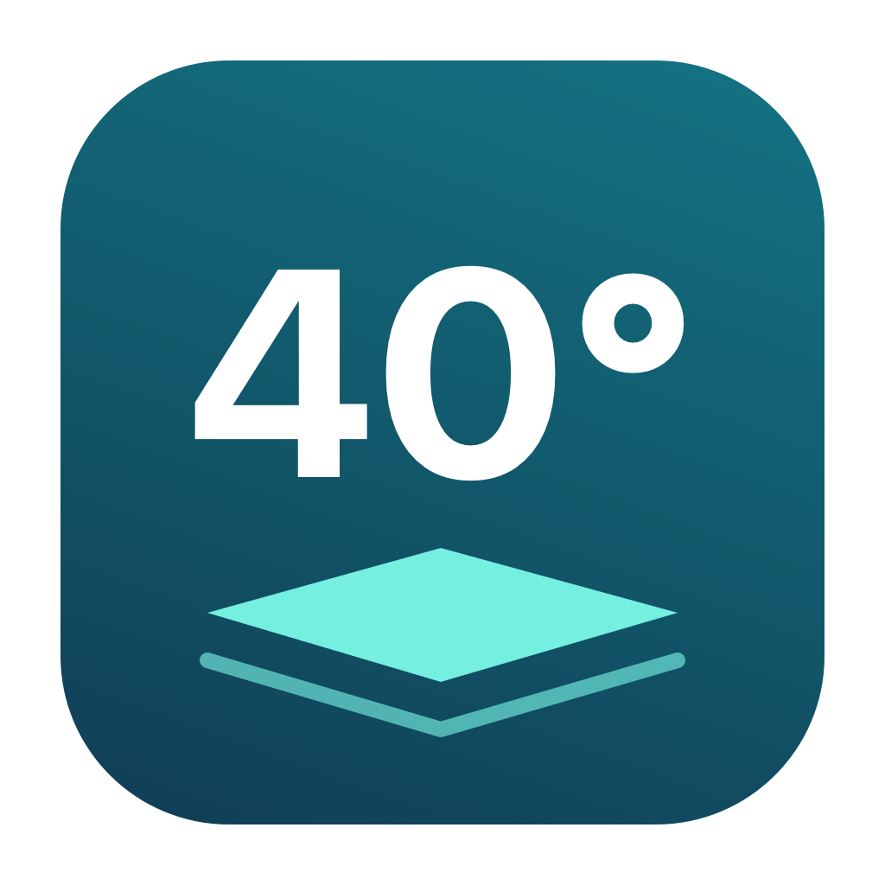

# Bambu 冷打板助手



macOS / Windows 小工具，一键修改本机官方 Bambu PETG Basic 在低温增粘板 SuperTack 上的热床温度，不用给多色项目逐个选择自定义耗材预设。

**温度默认 40℃，可以自己输入；只保留「应用温度」和「恢复默认」两个操作。**

## 当前开发状态

以下功能已在源码中实现，按作者要求暂不打包或发布。现有 Release 仍为旧版本。

## 下载与使用

从 [Releases](https://github.com/taosiqi/bambu-cool-plate-helper/releases/latest) 下载对应 ZIP，解压后双击应用。

| 平台 | 下载包 | 要求 |
| --- | --- | --- |
| macOS | 待打包：arm64 / x86_64 两种架构 | Apple Silicon / Intel，macOS 13+ |
| Windows | `BambuCoolPlateHelper-v1.3.0-windows-x64.zip` | Windows 10/11 x64，.NET Framework 4.8 |

1. 保存项目并退出 Bambu Studio（Mac 使用 `⌘Q`）。
2. 输入热床温度，默认填入 **40℃**，点击「应用温度」。
3. 重新打开 Studio，确认使用官方 Bambu PETG Basic 和低温增粘板，检查首层及其他层温度，再重新切片。

首层和其他层使用同一个温度，输入范围为 **1–120℃整数**。此范围只是软件参数边界，不代表你的板材、耗材或打印机适合所有温度；40℃也是本工具的默认输入值。

Windows 版不需要安装 Python 或独立 .NET SDK。两端都有 GitHub 仓库和 MakerWorld 作者主页入口。Mac 为本地临时签名，未经过 Apple 公证；Windows 未做代码签名。

## 修改范围

- 机器与喷嘴：动态扫描本机官方目录中所有 `Bambu PETG Basic @*.json`，包含全部机型、喷嘴和公共基础预设，不写死机型列表。
- Mac：`~/Library/Application Support/BambuStudio/system/BBL/filament/`。
- Windows：`%APPDATA%\BambuStudio\system\BBL\filament\`。
- 字段：`supertack_plate_temp`、`supertack_plate_temp_initial_layer`。

不修改其他板型、PETG HF、自定义耗材或项目文件。旧 3MF 的独立覆盖、已切片文件不会随之改变。官方配置更新可能覆盖修改，再次运行即可重新应用。尚未进行实际打印验收。

## 恢复默认

「恢复默认」还原**每份预设首次备份的两个温度字段**，保留其他设置。不是恢复成输入框默认的 40℃，也不是重新下载当前官方参数。

原来没有显式设置的字段会删除并恢复继承状态，因此继承后的实际温度取决于当前上级预设。恢复会覆盖后来手动设置或官方更新的这两个字段。

不扫描或导入旧版历史快照；首次修改时直接将原文件保存到 `Backups/initial/`，后续改成 45℃、50℃等都不会替换最初记录。每次实际修改前仍保留完整文件快照，重复应用相同数值不创建新快照。

备份目录：

- Mac：`~/Library/Application Support/BambuCoolPlateHelper/Backups/`
- Windows：`%APPDATA%\BambuCoolPlateHelper\Backups\`

## 构建与验证

Mac 的 **Verify macOS** CI 使用 `macos-15`（Apple Silicon）和 `macos-15-intel`（Intel）分别原生编译并运行自测，核对二进制架构；只验证，不生成应用包或发布。

本地仅编译与自测（需要 Xcode Command Line Tools）：

```sh
./verify-macos.sh
```

Windows 使用 PowerShell 和系统 .NET Framework 4.x 编译器：

```powershell
./windows/build.ps1
```

产物位于 `dist/`。GitHub Actions 的 **Verify Windows** 工作流仅编译测试程序、执行临时目录自测并输出窗口预览，不生成下载包。Windows 本机可用 `./windows/build.ps1 -TestOnly` 运行同样的验证。自测不会修改真实 Studio 配置，覆盖全部机型及未来预设发现、排除 PETG HF、自定义温度、输入范围、重复应用、首次备份保留、忽略旧版快照、默认恢复、继承、无关字段保留、异常 JSON 和 Studio 进程识别。

图标源码为 `assets/generate-icon.swift`。在 Mac 上重新生成：

```sh
swift assets/generate-icon.swift assets
iconutil -c icns assets/AppIcon.iconset -o assets/AppIcon.icns
```

## 支持作者

如果工具帮你省下了逐个修改耗材的时间，欢迎到 [我的 MakerWorld 主页](https://makerworld.com.cn/@siqijson?appSharePlatform=copy) 看看作品，求助力，感谢支持！

[GitHub 仓库与更新](https://github.com/taosiqi/bambu-cool-plate-helper)

## 开发中（待打包）

温度支持输入，默认 40℃；移除「恢复上次修改」，统一为「恢复默认」（首次备份）。Mac 和 Windows 同步更新，支持全部机型的官方 PETG Basic 预设，保留图标。GitHub 和 MakerWorld 入口使用可点击控件、下划线和手型光标。
